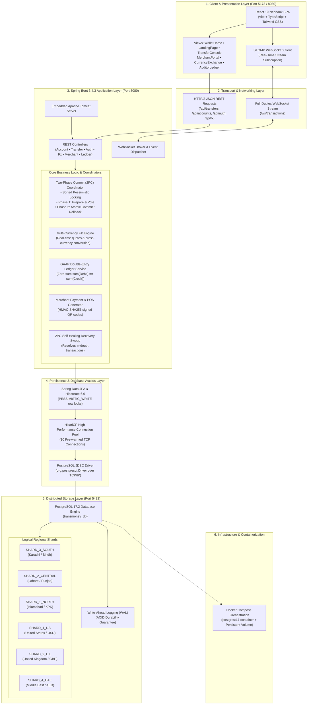
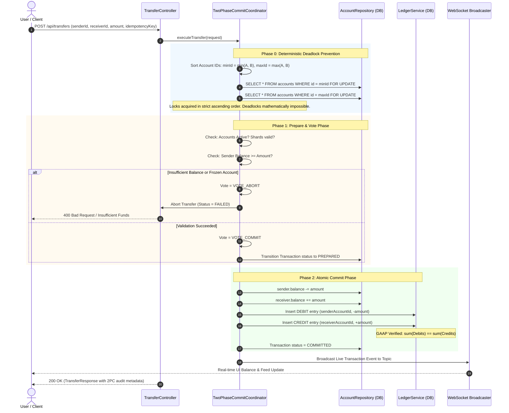

# Distributed Digital Wallet Transaction System (TransMoney)

A high-performance, fault-tolerant distributed digital wallet architecture built with **Java 21**, **Spring Boot 3**, **PostgreSQL 17**, and **React 19**. Features an ACID-compliant **Two-Phase Commit (2PC) Distributed Coordinator** for cross-shard/cross-border money transfers, deterministic pessimistic deadlock prevention, real-time WebSocket notifications, multi-currency foreign exchange (FX) conversion, HMAC-SHA256 merchant QR payments, and immutable double-entry ledger bookkeeping.

---

## 👥 Course & Academic Attribution
- **Course:** Distributed Database Systems
- **Instructor:** Sir Umair
- **Target Submission:** September 28, 2026 (Updated: October 2026)
- **Team Members:**
  - **Shehzad Nisar** (B22110006147)
  - **Muhammad Ashraf** (B22110006090)
  - **Daniyal Ahmed** (B21110006024)

---

## 🏗️ End-to-End System Architecture Diagram



---

## 🔄 Two-Phase Commit (2PC) Protocol Execution Flow

When money is transferred across accounts (especially across different geographical shards or currencies), the **Two-Phase Commit Protocol** ensures that either **both** accounts are updated and double-entry ledger records created, or **neither** is modified (strict Atomic Consistency).



---

## ❓ Frequently Asked Architectural Questions

### 1. Database Connection Flow: How Does it Connect?
1. **No External Web Server Needed:** Spring Boot embeds an optimized **Apache Tomcat** instance. It directly accepts HTTP REST and WebSocket connections on port `8080`.
2. **Connection Pooling via HikariCP:** Instead of incurring a 50–100ms TCP handshake overhead for every HTTP request, **HikariCP** maintains 10 pre-warmed database connections.
3. **Pessimistic Row-Level Locking:** When executing financial operations, Hibernate issues `SELECT ... FOR UPDATE` via the official PostgreSQL JDBC driver. PostgreSQL's internal lock manager acquires row-level exclusive locks in memory, guaranteeing strict isolation (`SERIALIZABLE` / `READ_COMMITTED`).
4. **Write-Ahead Logging (WAL):** When committed, PostgreSQL flushes the transaction log to WAL on disk, guaranteeing Durability (the D in ACID) even in the event of an abrupt power failure.

### 2. Why Don't We Need Laragon, XAMPP, or an External Web Server?
* **Laragon/XAMPP Purpose:** These suites bundle PHP interpreters, Apache HTTPD, and MySQL for PHP scripts.
* **Our Modern Stack:** Our backend is written in **Java 21 using Spring Boot 3**. Spring Boot compiles into a self-contained executable with its own embedded web server and uses **PostgreSQL 17**, which communicates directly over native TCP port `5432`.
* **Embedded Production Frontend:** The React production build is compiled and synchronized directly into `backend/src/main/resources/static/`. Running the Spring Boot application serves both the backend API and the frontend dashboard from a single port (`8080`).

### 3. Why Do We Use Docker?
* **"Works on Every Machine" Guarantee:** Evaluators or team members can boot the exact PostgreSQL 17.2 database with pre-configured databases, users, and ports in seconds without manual Windows software installation:
  ```powershell
  docker compose up -d
  ```
* **Production Environment Parity:** Modern distributed banking engines (e.g., Wise, Revolut, Stripe) run database nodes and microservices inside containerized orchestration environments (Docker/Kubernetes). Including Docker demonstrates enterprise-grade DevOps readiness.
* **Zero Pollution:** Data is mounted inside an isolated Docker volume (`postgres_data`). No clutter is left on the host system.

---

## 🏛️ Project Directory Structure

```
Distributed-Digital_Wallet/
├── docker-compose.yml                         # Orchestration for PostgreSQL 17 & Redis
├── README.md                                  # Comprehensive System Documentation & Architecture Guide
├── TransMoney_Postman_Collection.json         # Complete Postman Collection for automated grading
│
├── backend/                                   # Spring Boot 3.4.3 Application (Port 8080)
│   ├── pom.xml                                # Maven Dependencies (Spring Data JPA, WebSocket, PostgreSQL, OpenAPI)
│   ├── src/main/java/com/transmoney/backend/
│   │   ├── BackendApplication.java            # Main Spring Boot Entrypoint
│   │   ├── config/
│   │   │   ├── CorsConfig.java                # Cross-Origin Resource Sharing policy
│   │   │   ├── DataInitializer.java           # Auto-seeds multi-currency accounts and initial demo ledger
│   │   │   ├── OpenApiConfig.java             # OpenAPI 3.0 / Swagger documentation config
│   │   │   └── WebSocketConfig.java           # STOMP / SockJS real-time messaging configuration
│   │   ├── controller/                        # REST API Controllers
│   │   │   ├── AccountController.java         # /api/accounts (Deposit, Withdraw, Freeze/Unfreeze, Balance)
│   │   │   ├── AuthController.java            # /api/auth (Login, Register, Session token)
│   │   │   ├── FxController.java              # /api/fx (Live exchange rates, quotes, instant exchange)
│   │   │   ├── HealthController.java          # /api/health (Live PostgreSQL connection probe)
│   │   │   ├── LedgerController.java          # /api/ledger (Double-entry audit, reconciliation, CSV export)
│   │   │   ├── MerchantController.java        # /api/merchants (Dynamic HMAC QR invoices, POS terminals)
│   │   │   ├── SimulatorController.java       # /api/simulator (Chaos testing, network latency inject)
│   │   │   ├── SystemBufferController.java    # /api/system (Cache & async queue telemetry)
│   │   │   ├── TransferController.java        # /api/transfers (2PC distributed money movement)
│   │   │   └── UserController.java            # /api/users (User directory)
│   │   ├── service/                           # Business Logic & Algorithms
│   │   │   ├── AccountService.java
│   │   │   ├── FxService.java                 # FX rate calculations and multi-currency exchange
│   │   │   ├── LedgerService.java             # Double-entry debit/credit ledger builder
│   │   │   ├── MerchantService.java           # HMAC-SHA256 signature generator & QR encoder
│   │   │   ├── UserService.java
│   │   │   ├── coordinator/
│   │   │   │   ├── TwoPhaseCommitCoordinator.java  # Core 2PC Engine (Lock, Prepare, Commit)
│   │   │   │   └── TwoPhaseCommitRecovery.java     # Self-healing recovery worker for in-doubt txs
│   │   │   └── queue/
│   │   │       ├── AsyncTransactionEventConsumer.java  # Async transaction event processor
│   │   │       └── InMemoryTransactionQueue.java       # High-throughput ring-buffer queue
│   │   ├── repository/                        # Spring Data JPA Repositories
│   │   │   ├── AccountRepository.java         # findByIdForUpdate (PESSIMISTIC_WRITE)
│   │   │   ├── LedgerEntryRepository.java     # Double-entry immutable audit trail
│   │   │   ├── MerchantRepository.java
│   │   │   ├── SettlementBatchRepository.java
│   │   │   ├── TransactionRepository.java     # JpaSpecificationExecutor for multi-criteria search
│   │   │   └── UserRepository.java
│   │   └── entity/                            # PostgreSQL JPA Relational Entities
│   │       ├── Account.java                   # Account balances, currency, shard, status, version
│   │       ├── LedgerEntry.java               # Immutable ledger row (DEBIT/CREDIT)
│   │       ├── Merchant.java                  # Merchant profile & accumulated POS volume
│   │       ├── SettlementBatch.java           # End-of-day merchant settlement batch
│   │       ├── Transaction.java               # Distributed transaction master record
│   │       ├── User.java                      # User entity with auth credentials
│   │       └── enums/
│   │           ├── AccountStatus.java         # ACTIVE, FROZEN, CLOSED
│   │           ├── LedgerEntryType.java       # DEBIT, CREDIT
│   │           ├── ShardType.java             # Multi-region shards (US, UK, SG, UAE, PK)
│   │           ├── TransactionStatus.java     # INITIATED, PREPARED, COMMITTED, FAILED
│   │           └── TransactionType.java       # P2P_TRANSFER, MERCHANT_PAYMENT, DEPOSIT, WITHDRAWAL, FX_EXCHANGE
│   └── src/main/resources/
│       ├── application.yml                    # Database, HikariCP, and JPA configuration
│       └── static/                            # Pre-bundled React 19 production distribution
│
└── frontend/                                  # React 19 Frontend Web Application (Port 5173)
    ├── package.json                           # Dependencies (React 19, Lucide, Tailwind CSS v4, Axios)
    ├── vite.config.ts                         # Vite build configuration with /api proxy to port 8080
    └── src/
        ├── api/client.ts                      # Axios REST client covering all backend endpoints
        ├── api/websocket.ts                   # STOMP over WebSocket event subscriber
        ├── types/index.ts                     # TypeScript interfaces matching backend DTOs
        └── components/
            ├── App.tsx                        # Master layout coordinator & WebSocket toast notifier
            ├── AuthModal.tsx                  # Dynamic user picker, registration with custom initial deposit
            ├── LandingPage.tsx                # Consumer landing experience (dynamic card, balance, and quick actions)
            ├── WalletHome.tsx                 # Neobank Dashboard (Interactive Debit Card, Multi-Currency Pots, Real Cash Flow)
            ├── TransferConsole.tsx            # Live 2PC step-by-step visualizer & transfer executor
            ├── CurrencyExchange.tsx          # Real-time multi-currency FX converter
            ├── MerchantPortal.tsx             # HMAC-SHA256 dynamic & static QR POS terminal
            ├── AuditorDashboard.tsx           # Official double-entry ledger & CSV statement exporter
            ├── CoreBankingConsole.tsx         # Account freeze/unfreeze, limit manager, direct deposit routing
            ├── ShardClusterView.tsx           # Multi-shard regional topology visualizer
            ├── ChaosSimulatorView.tsx         # Network latency injection & node failure simulator
            ├── CreateAccountModal.tsx         # Multi-currency pot creator
            └── DepositWithdrawModal.tsx       # Live deposit and withdrawal modal
```

---

## ⚡ Core Distributed Database Protocols & Features

### 1. Two-Phase Commit (2PC) Cross-Shard Coordinator
- **Phase 0 (Pessimistic Deadlock Elimination):** Sorts account IDs ascending (`minId` locked before `maxId`) using `SELECT ... FOR UPDATE` (`PESSIMISTIC_WRITE`). Eliminates circular wait deadlocks.
- **Phase 1 (Prepare / Vote):** Validates account status, verifies sufficiency of funds, checks currency compatibility. Votes `VOTE_COMMIT` or `VOTE_ABORT`.
- **Phase 2 (Atomic Commit):** Applies balance modifications and writes double-entry ledger entries in an all-or-nothing database transaction.
- **Self-Healing Recovery Sweep:** Background daemon (`TwoPhaseCommitRecovery`) periodically inspects in-doubt transactions and safely aborts or reconciles dangling operations.

### 2. GAAP-Compliant Double-Entry Ledger Bookkeeping
Every transaction writes paired, immutable ledger entries:
$$\sum \text{Debits} == \sum \text{Credits}$$
- Prevents balance fabrication.
- Provides real-time reconciliation verification (`/api/ledger/reconcile/{accountId}`).

### 3. Multi-Currency Engine & Foreign Exchange (FX)
- Holds multi-currency pots per customer (PKR, USD, GBP, EUR, AED, SGD).
- Real-time zero-spread quote generation and instant cross-currency atomic exchange.

### 4. Merchant Cryptographic QR Payments
- Generates **HMAC-SHA256 signed** QR code payloads for dynamic point-of-sale invoices.
- Validates cryptographic signatures to prevent tampering or replay attacks before executing atomic settlement.

### 5. Multi-Region Shard Topology
- 🇵🇰 **`SHARD_1_NORTH`**: Pakistan (Islamabad / North Region)
- 🇵🇰 **`SHARD_2_CENTRAL`**: Pakistan (Lahore / Punjab Region)
- 🇵🇰 **`SHARD_3_SOUTH`**: Pakistan (Karachi / Sindh Region)
- 🇺🇸 **`SHARD_1_US`**: United States (North America • New York / AWS `us-east-1`)
- 🇬🇧 **`SHARD_2_UK`**: United Kingdom (Europe • London / AWS `eu-west-2`)
- 🇦🇪 **`SHARD_4_UAE`**: United Arab Emirates (Middle East • Dubai DIFC Treasury)

---

## 🚀 Step-by-Step Execution Guide

### Option A: Using Docker (Recommended for Evaluators)

Start the PostgreSQL 17 database with one command:
```powershell
docker compose up -d
```

---

### Option B: Using Local Native PostgreSQL

If using a local PostgreSQL installation:
```powershell
& "D:\tools\pgsql\pgsql\bin\postgres.exe" -D "D:\tools\pgsql\data"
```
*(Verify readiness with `& "D:\tools\pgsql\pgsql\bin\pg_isready.exe" -h localhost -p 5432`)*

---

### Running the Backend

From the project root:
```powershell
cd backend
.\mvnw.cmd spring-boot:run
```
- **Backend API:** `http://localhost:8080`
- **Swagger Documentation:** `http://localhost:8080/swagger-ui/index.html`
- **Pre-Bundled Web Dashboard:** `http://localhost:8080/`

---

### Running the Frontend (Development Mode)

In a separate terminal:
```powershell
cd frontend
npm install
npm run dev
```
- **Live Frontend Server:** `http://localhost:5173`
- Features hot-module reloading and automatic proxying of `/api` requests to port `8080`.

---

## 🧪 Automated Verification & Test Suite

The project includes **35 comprehensive automated integration tests** covering the entire distributed architecture.

Run the test suite:
```powershell
cd backend
.\mvnw.cmd test
```

### Verified Test Coverage Summary:
- **`TwoPhaseCommitIntegrationTest`** (2 Tests): Successful cross-shard 2PC transfers, insufficient balance rejection, zero-sum ledger verification.
- **`MultiCurrencyAndFxIntegrationTest`** (8 Tests): Live FX quote generation, cross-currency balance exchange, multi-currency ledger balance consistency.
- **`MerchantPortalIntegrationTest`** (6 Tests): HMAC-SHA256 QR invoice generation, signature validation, tamper prevention, automated merchant fee settlement.
- **`TwoPhaseCommitRecoveryIntegrationTest`** (4 Tests): Self-healing coordinator recovery sweep, in-doubt transaction resolution.
- **`TransactionSearchAndApiIntegrationTest`** (5 Tests): Multi-criteria keyword search, numeric range B-tree filtering, OpenAPI Swagger validation.
- **`AccountLifecycleIntegrationTest`** (4 Tests): Account creation, freeze/unfreeze security toggles, deposit/withdrawal validation.
- **`IdempotencyIntegrationTest`** (3 Tests): Duplicate request deduplication, concurrent idempotency key protection.
- **`BackendApplicationTests`** (3 Tests): Spring Boot application context and HikariCP connection pool health.

**Result:** `Tests run: 35, Failures: 0, Errors: 0, Skipped: 0` (**100% Pass**).

---

## 📡 Essential REST API Endpoints

| Category | Method | Endpoint | Description |
| :--- | :---: | :--- | :--- |
| **System Health** | `GET` | `/api/health` | Live PostgreSQL connection & cluster health probe |
| **2PC Transfer** | `POST` | `/api/transfers` | Executes cross-shard Two-Phase Commit transaction |
| **Account Info** | `GET` | `/api/accounts/{id}` | Fetches account details, balance, and regional shard |
| **Account Transactions** | `GET` | `/api/accounts/{id}/transactions` | Paginated search, sort, and date-filtered activity ledger |
| **Freeze / Unfreeze** | `PATCH`| `/api/accounts/{id}/status` | Card security toggle (`ACTIVE` / `FROZEN`) |
| **Deposit / Withdraw** | `POST` | `/api/accounts/{id}/deposit` | Funds top-up or outward wire withdrawal |
| **FX Rates** | `GET` | `/api/fx/rates` | Real-time multi-currency exchange rate table |
| **FX Quote** | `POST` | `/api/fx/quote` | Zero-spread FX conversion quote |
| **FX Exchange** | `POST` | `/api/fx/exchange` | Instant atomic foreign currency pot conversion |
| **Merchant QR Generate**| `POST`| `/api/merchants/qr/generate` | Generates signed HMAC-SHA256 QR code payload |
| **Merchant QR Scan** | `POST` | `/api/merchants/qr/scan` | Validates QR cryptography and decodes payload |
| **Merchant QR Pay** | `POST` | `/api/merchants/qr/pay` | Executes atomic merchant POS checkout |
| **Double-Entry Ledger** | `GET` | `/api/ledger/entries` | Full system GAAP debits and credits ledger |
| **Reconcile Account** | `GET` | `/api/ledger/reconcile/{id}` | Verifies $\sum \text{Debits} == \sum \text{Credits}$ balance |
| **CSV Statement** | `GET` | `/api/ledger/accounts/{id}/statement/csv` | Streams official bank statement in CSV format |
