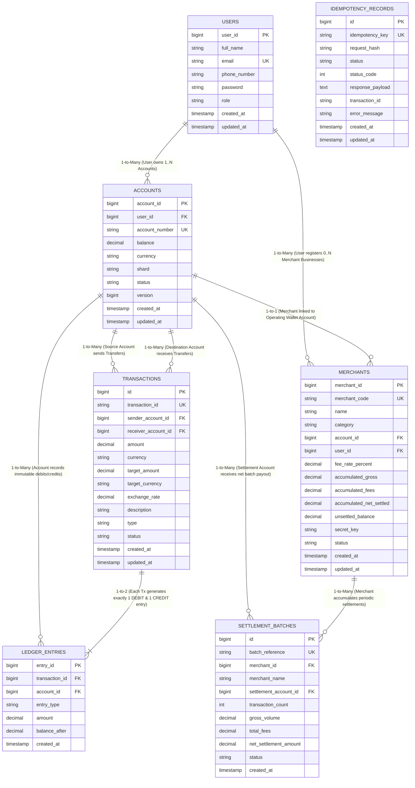

# TransMoney Distributed Digital Wallet - Entity Relationship (ER) Diagram

**Course:** Distributed Database Systems (Sir Umair)  
**Database Engine:** PostgreSQL 17  
**Schema Model:** Horizontally Sharded Ledger Architecture  

---

## 1. Visual Entity Relationship (ER) Diagram

---

## 2. Relational Schema & Partitioning Specification

### 1. `users` (Identity & Security Partition)
- **Primary Key:** `user_id` (`BIGSERIAL`)
- **Key Fields:** `email` (Unique), `full_name`, `password` (BCrypt hash), `role` (`ROLE_USER`, `ROLE_ADMIN`).
- **Relationship:** One user can own multiple multi-currency accounts across regional shards.

### 2. `accounts` (Distributed Shard Partition)
- **Primary Key:** `account_id` (`BIGSERIAL`)
- **Foreign Key:** `user_id -> users(user_id)`
- **Key Fields:**
  - `shard`: Regional partition (`SHARD_1_NORTH`, `SHARD_2_CENTRAL`, `SHARD_3_SOUTH`, `SHARD_4_ENTERPRISE`).
  - `balance`: Exact financial precision (`DECIMAL(18,2)`).
  - `currency`: ISO-4217 code (`PKR`, `USD`, `EUR`, `GBP`, `AED`).
  - `version`: Optimistic lock versioning token (`BIGINT`).
- **Indexes:**
  - `idx_account_number` (`UNIQUE` on `account_number`)
  - `idx_account_user_id` (B-Tree on `user_id`)
  - `idx_account_shard` (B-Tree on `shard` for partition pruning)

### 3. `transactions` (Global 2PC Transaction Log)
- **Primary Key:** `id` (`BIGSERIAL`)
- **Key Fields:**
  - `transaction_id`: UUIDv4 tracking identifier (`TX-...`).
  - `sender_account_id` & `receiver_account_id`: Source and destination accounts.
  - `amount`, `currency`, `target_amount`, `target_currency`, `exchange_rate` (FX Conversion).
  - `status`: Two-Phase Commit state machine (`INITIATED`, `PREPARED`, `COMMITTED`, `ABORTED`, `FAILED`).
- **Indexes:**
  - `idx_tx_transaction_id` (`UNIQUE`)
  - `idx_tx_sender_account`
  - `idx_tx_receiver_account`
  - `idx_tx_created_at_amount` (Composite index for high-speed chronological queries)

### 4. `ledger_entries` (Immutable GAAP Double-Entry Journal)
- **Primary Key:** `entry_id` (`BIGSERIAL`)
- **Foreign Key:** `transaction_id -> transactions(id)`
- **Key Fields:**
  - `account_id`: Account experiencing balance change.
  - `entry_type`: `DEBIT` (outflow) or `CREDIT` (inflow).
  - `amount`: Transaction increment.
  - `balance_after`: Snapshot balance after atomic commit.
- **Mathematical Invariant:** For every committed transaction:
  $$\sum \text{Debit} - \sum \text{Credit} = 0.00$$

### 5. `idempotency_records` (Distributed Deduplication Store)
- **Primary Key:** `id` (`BIGSERIAL`)
- **Key Fields:**
  - `idempotency_key`: Client-generated UUIDv4 key.
  - `request_hash`: SHA-256 payload digest.
  - `status`: `PENDING`, `COMPLETED`, `FAILED`.
  - `response_payload`: Cached atomic response for duplicate replay.

### 6. `merchants` & `settlement_batches` (Commercial Clearing)
- Supports business operations, point-of-sale QR code payments, accumulated gross transactions, fee deduction (e.g. 1.5%), and scheduled net settlement batch execution.
